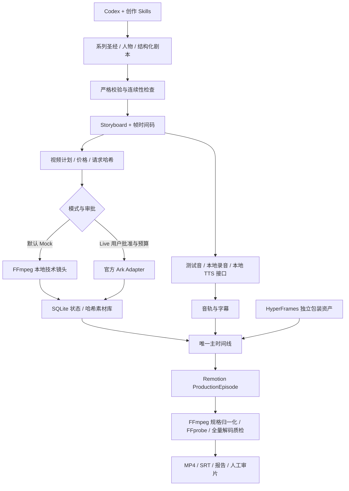

# 制作架构与数据契约

## 数据与执行

人物数据见 `docs/templates/characters.schema.json`，剧本见 `script.schema.json`，分镜见 `storyboard.schema.json`。校验器拒绝非法数值、重复身份、缺失角色引用、越界对白及不完整镜头。旧 EP001 空镜头草稿保留，但不能执行视频任务。

结构化剧本由场景内镜头转换为同一分镜契约，保留镜头 ID。角色具备外观、造型、道具、多视角参考方案、声音和历史镜头设定。连续性检查覆盖元数据，不能从实际画面证明人物脸部一致或剧情合理。

`VideoEngine` 通过 Adapter 分离创作与服务商。规范化请求、参考文件内容、模型/报价组成请求哈希；镜头身份与哈希组成任务键。SQLite 保存 provider task ID、任务状态、尝试次数、预算预留和事件。完成素材必须通过解码、大小和 SHA-256 检查；重复推进读取原任务，未知提交不会重试付费提交。共享项目账本负责跨集预算，独立运行目录保存每集管线记录。

存储通过 `ArtifactStorage` 接口替换，当前只有真实可用的 `LocalStorage`。外部挂载卷可用，对象存储 SDK 尚未实现。跨机器恢复先保存原账本和素材，随后显式重绑定；不自动复制、上传或重提任务。

## 时间线与音频

所有排程使用整数帧。分镜对白相对镜头，音轨/SRT 转换为整集时间；最终 SRT 再加片头偏移。镜头媒体、音轨、字幕、片头尾及转场由 `short-drama.timeline/v1` 描述；Remotion 按计算后的时长渲染，多镜头无缝排布，淡变在镜头内部执行，不隐式改变对白偏移。

输入可以混用图片与视频，音频支持角色对白、BGM、环境音和音效。Mock 使用不同角色测试音；local 使用已授权录音，Piper 是可注入的本地 TTS 接口。中文声音权重未随仓库分发。缓存同时校验生成音轨与来源录音/BGM/SFX 哈希，修改源音频会产生新版本。

## 检查点及权限

`run.json`、`events.jsonl` 与 SQLite 持久保存状态。管线互斥锁防止同一运行目录并发推进；任务状态库限制同一镜头并发领取。输出文件禁止覆盖，输入或执行上下文改变要求新运行或显式迁移。Live 创意审批与付费审批分开核对；仓库仅提供未批准示例。

本地技术链路已实际渲染；Ark 适配器只做模拟 HTTP 测试。远端队列、Webhook、定时轮询、自动视觉质检与远程存储解析未部署。详见 [云端执行](cloud-runtime.md)。
